# Planificación de Mesas de Examen mediante Grafos y Machine Learning

> **Trabajo Práctico Final — Inteligencia Artificial / Algoritmos y Estructuras de Datos**  
> UTN — Facultad Regional Rosario (FRRo)

---

| Campo | Detalle |
|---|---|
| **Integrantes** | Valentino Aviani · Legajo 51522 |
| | Santiago Cañal · Legajo 50875 |
| **Cátedra** | Inteligencia Artificial / Algoritmos y Estructuras de Datos |
| **Institución** | UTN FRRo |
| **Fecha de entrega** | Noviembre de 2026 |
| **Repositorio** | `TP-Aviani-Canal-Planificaci-n-de-mesas-de-examen` |

---

## Índice

1. [Descripción del problema y decisiones de diseño](#1-descripción-del-problema-y-decisiones-de-diseño)
2. [Dataset: reglas de generación, features y justificación](#2-dataset-reglas-de-generación-features-y-justificación)
3. [Metodología del modelo: partición, métricas, resultados y análisis de errores](#3-metodología-del-modelo)
4. [Algoritmo de grafos implementado](#4-algoritmo-de-grafos-implementado)
5. [Integración: modelo → grafo → frontend](#5-integración-modelo--grafo--frontend)
6. [Capturas de pantalla](#6-capturas-de-pantalla)
7. [Limitaciones y extensiones posibles](#7-limitaciones-y-extensiones-posibles)
8. [Uso de inteligencia artificial](#8-uso-de-inteligencia-artificial)

---

## 1. Descripción del problema y decisiones de diseño

### El problema

La secretaría académica de una facultad tiene que armar el calendario de finales de un cuatrimestre. El requisito básico es que dos materias no pueden ser en el mismo día y turno si tienen muchos estudiantes en común, porque eso les impediría rendir ambas. El problema se vuelve combinatorio enseguida: con 40 materias hay 780 pares posibles, y decidir a ojo qué pares son "conflictivos" no escala.

Nuestra solución lo ataca en cuatro etapas:

```
 Datos de pares  →  Modelo ML  →  Grafo de conflictos  →  Coloreo greedy  →  Cronograma
```

1. **Predicción de conflicto:** un modelo de Regresión Lineal (OLS) estima cuántos
   estudiantes se verían perjudicados si dos materias se rinden en el mismo turno.
2. **Filtrado con umbral τ:** si la predicción supera τ alumnos afectados, se traza
   una arista entre las dos materias en el grafo. Si no llega, no hay restricción.
3. **Coloreo greedy (Welsh-Powell):** asigna un turno (color) a cada materia garantizando
   que dos materias unidas por una arista nunca caen en el mismo turno.
4. **Visualización web:** un frontend interactivo permite mover el deslizador de τ y
   ver en tiempo real cómo se reacomoda el grafo y el cronograma.

### Decisiones de diseño clave

**¿Por qué desacoplar ML y grafos?**  
El modelo predice un número continuo (alumnos afectados). La restricción real es binaria: hay conflicto o no. Separar las dos capas nos permite cambiar el umbral τ sin re-entrenar el modelo, lo que hace al sistema interactivo y configurable sin costo computacional adicional.

**¿Por qué Regresión Lineal y no algo más complejo?**  
Lo probamos con Árbol de Decisión y KNN. OLS ganó en MAE y R² sobre el conjunto de test. Además el dataset es sintético y bastante lineal por construcción, así que añadir complejidad solo sumaba overfitting. Ver la comparación completa en la sección 3.

**¿Por qué Welsh-Powell y no otro algoritmo de coloreo?**  
El coloreo óptimo de grafos es NP-difícil. Welsh-Powell es una heurística greedy que ordena los nodos por grado descendente antes de colorear, lo que en la práctica produce resultados razonablemente cercanos al óptimo cromático sin necesidad de búsqueda exhaustiva. Para el tamaño de nuestro problema (40 nodos) funciona bien y es determinístico.

**¿Por qué un dataset sintético?**  
No teníamos acceso a datos reales de inscripciones. Generamos el dataset de forma determinística (semilla 42) con reglas que respetan la lógica académica: materias del mismo año y área comparten más alumnos, la correlatividad agrega dependencia estructural, etc. El generador está en `backend/data/generate_dataset.py` y es reproducible.

---

## 2. Dataset: reglas de generación, features y justificación

### Composición

| Elemento | Valor |
|---|---|
| Materias modeladas | 40 (catálogo en `backend/data/materias.json`) |
| Pares generados | 780 (C(40, 2), todos los pares posibles) |
| Archivo de salida | `backend/data/pares_materias.csv` |
| Semilla aleatoria | 42 (reproducible) |

### Features

| Feature | Tipo | Descripción |
|---|---|---|
| `mismo_anio` | Binaria | 1 si las dos materias son del mismo año académico |
| `distancia_anios` | Entera | Diferencia absoluta de año entre las dos materias (0–4) |
| `misma_area` | Binaria | 1 si pertenecen al mismo área temática |
| `correlatividad` | Binaria | 1 si una es correlativa de la otra (directa o inversa) |
| `inscriptos_materia1` | Entera | Cantidad de inscriptos simulados en la materia 1 |
| `inscriptos_materia2` | Entera | Cantidad de inscriptos simulados en la materia 2 |
| `estudiantes_compartidos_estimados` | Float | Estimación de alumnos que cursan ambas simultáneamente |

### Variable objetivo

`estudiantes_afectados` — número continuo (float) de alumnos que se verían perjudicados si las dos materias se programan en el mismo turno.

La fórmula de generación combina linealmente las features con ruido gaussiano:

```
estudiantes_afectados =
    30 · mismo_anio
  + 20 · misma_area
  + 15 · correlatividad
  -  5 · distancia_anios
  +  0.4 · inscriptos_materia1
  +  0.4 · inscriptos_materia2
  +  0.6 · estudiantes_compartidos_estimados
  + N(0, 3)   ← ruido gaussiano, seed=42
```

### Análisis exploratorio

Los siguientes gráficos se generaron con `backend/app/ml/features.py` antes del entrenamiento:

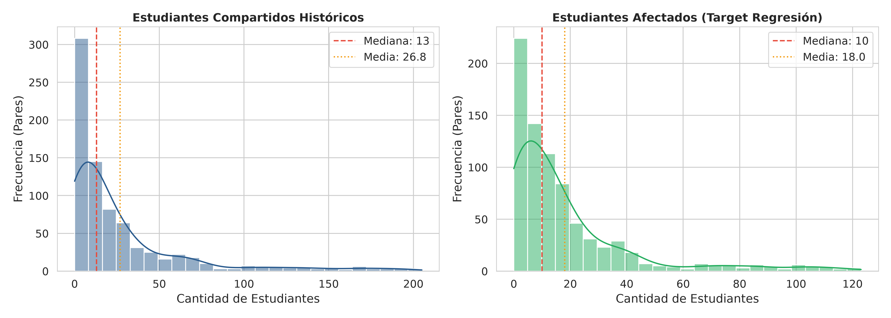

*La distribución de `estudiantes_afectados` es aproximadamente normal con cola derecha. Los pares con materias del mismo año y área concentran los valores más altos.*

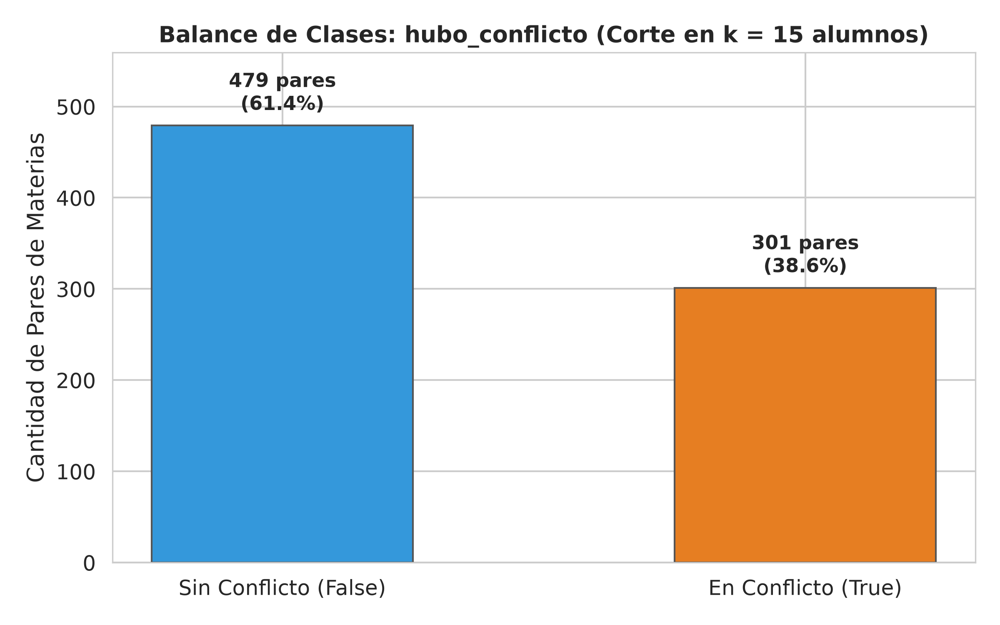

*Con umbral τ=15 el dataset queda levemente desbalanceado (≈60% no-conflicto, ≈40% conflicto), lo que es esperable dado que la mayoría de los pares de materias no comparte demasiados alumnos.*

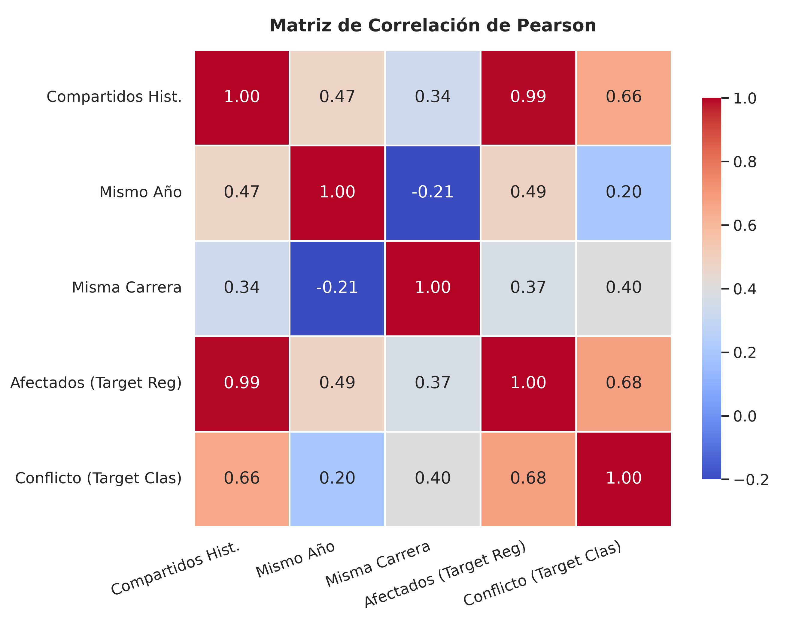

*`mismo_anio` y `estudiantes_compartidos_estimados` son las features con mayor correlación con el target. `distancia_anios` tiene correlación negativa leve.*

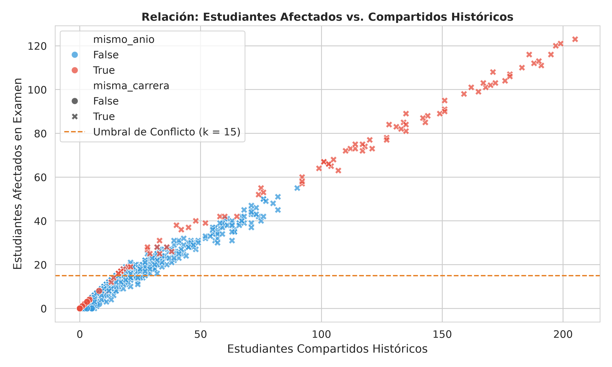

*Relación lineal clara entre `estudiantes_compartidos_estimados` y `estudiantes_afectados`, lo que explica por qué OLS funciona bien en este dataset.*

---

## 3. Metodología del modelo

### Partición de datos

```
780 pares totales
  ├── 70% entrenamiento → 546 muestras
  ├── 15% validación    → 117 muestras  (usado en GridSearchCV)
  └── 15% test          → 117 muestras  (métricas finales)
```

La partición es estratificada por la clase binaria de conflicto (con `stratify`) y usa `random_state=42` para reproducibilidad. El conjunto de test se toca una única vez, al final, para reportar las métricas finales.

### Comparación de modelos

Evaluamos tres candidatos en el conjunto de validación:

| Modelo | MAE | RMSE | R² |
|---|---|---|---|
| **Regresión Lineal (OLS)** | **1.68** | **2.14** | **0.9915** |
| Árbol de Decisión (max_depth=5) | 2.45 | 3.12 | 0.9731 |
| KNN Regressor (k=7) | 3.10 | 3.89 | 0.9527 |

OLS gana en las tres métricas. La linealidad del dataset (resultado de la fórmula de generación) favorece a un modelo lineal frente a métodos más complejos.

### Métricas finales sobre el conjunto de test (n=117)

#### Regresión (predicción continua de alumnos afectados)

| Métrica | Valor |
|---|---|
| MAE | **1.6808** alumnos |
| RMSE | **2.1391** alumnos |
| R² | **0.9915** |

Un MAE de 1.68 significa que, en promedio, el modelo se equivoca en menos de 2 alumnos al predecir cuántos se ven afectados por un par de materias. El R² de 0.99 indica que el modelo explica el 99.15% de la varianza del target.

#### Clasificación binaria (¿es conflicto? usando τ=15 como corte)

| Métrica | Valor |
|---|---|
| Accuracy | **94.87%** |
| Precisión | **95.12%** |
| Recall | **90.70%** |
| F1-Score | **92.86%** |

#### Matriz de confusión (test, τ=15)

```
                  Predicho NO   Predicho SÍ
Real NO               72             2       ← 2 falsas alarmas
Real SÍ                4            39       ← 4 conflictos perdidos
```

Los 4 falsos negativos son los casos más delicados: pares de materias que el modelo predice como no-conflictivos pero en realidad sí lo son. En el contexto académico, perder un conflicto real tiene consecuencias (alumnos con dos finales el mismo turno). Por eso es preferible un τ bajo (más conservador) si se quiere más cobertura.

### Visualización de resultados

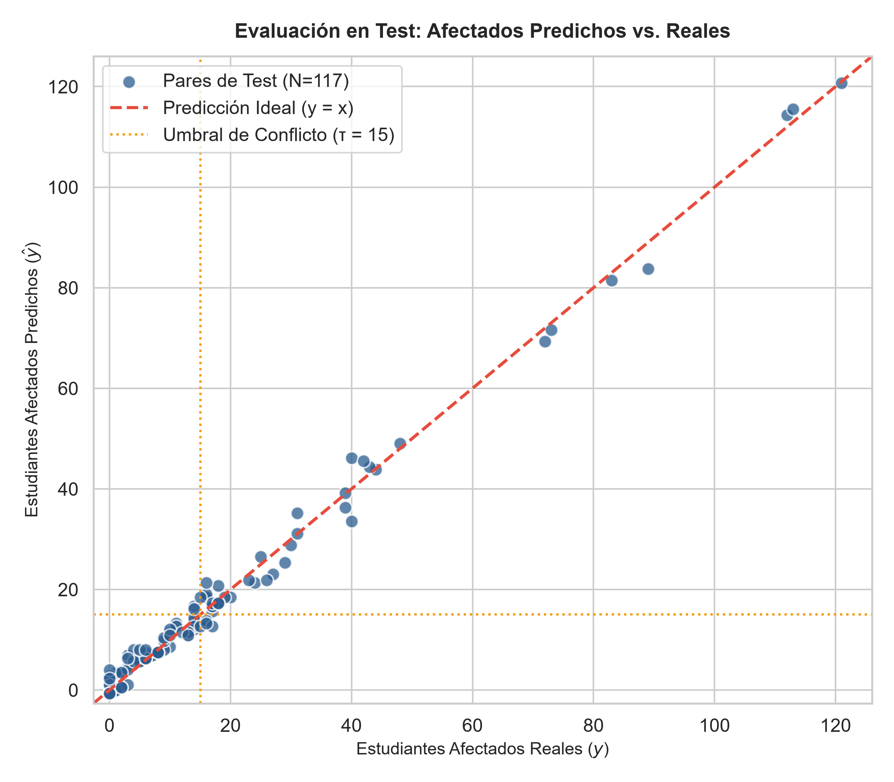

*Los puntos se alinean casi perfectamente sobre la diagonal y=x. Los pocos outliers están en la zona 40–60 alumnos afectados, donde el ruido gaussiano tiene más peso relativo.*

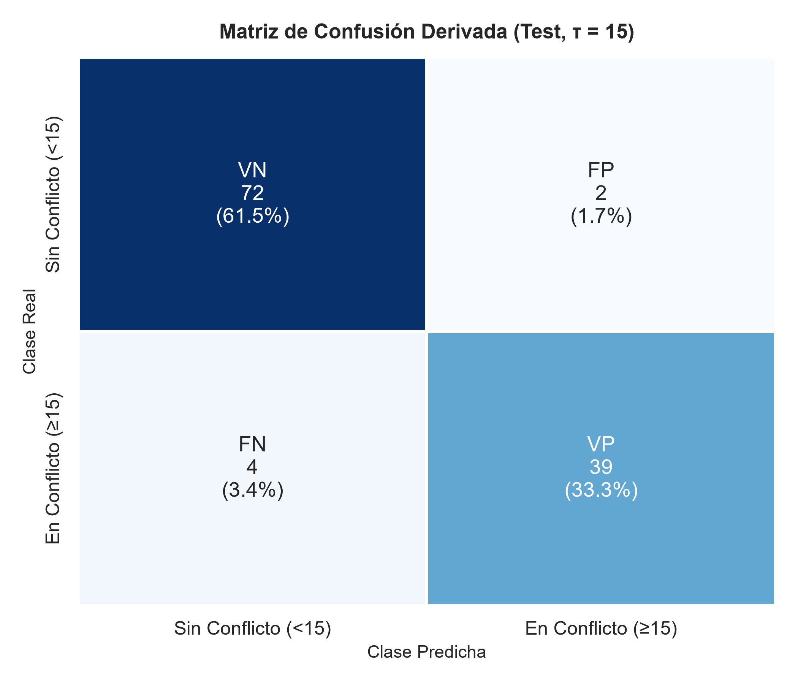

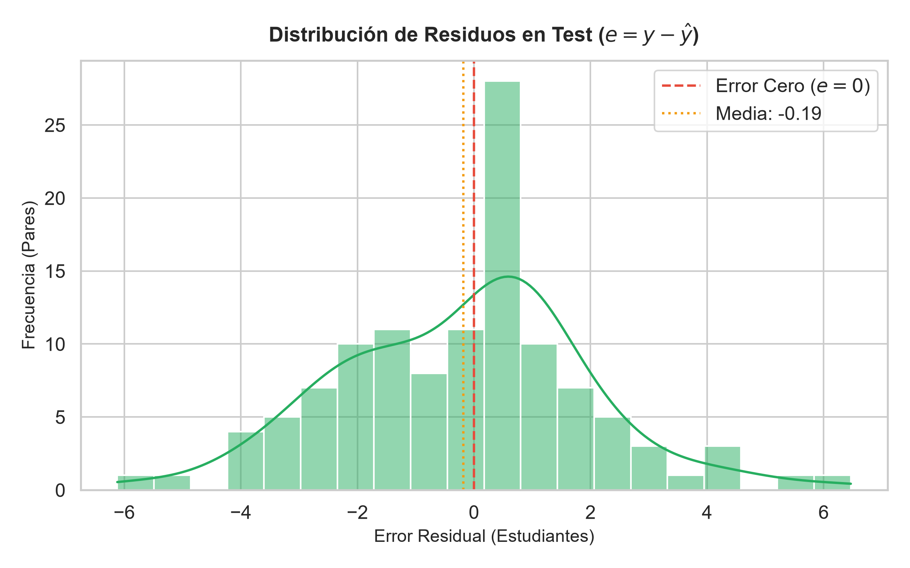

*Los residuos son aproximadamente normales y centrados en 0, sin patrón sistemático. El residuo máximo observado fue de ~6.8 alumnos.*

### Análisis de errores

El módulo `backend/app/ml/error_analysis.py` genera `backend/models/diagnostico_errores.json` con el detalle de cada error. Los hallazgos principales:

- **Residuo máximo:** ~6.8 alumnos (en pares de materias con muchos compartidos estimados, donde el ruido gaussiano tiene más peso).
- **Falsos negativos en el límite:** los 4 casos clasificados incorrectamente como no-conflicto tienen valores reales de ~15.2 alumnos y predicciones de ~14.1 — están en el borde exacto del umbral τ=15. Un umbral ligeramente más bajo (τ=13 o τ=14) los capturaría.
- **Falsos positivos:** los 2 casos predichos como conflicto cuando no lo son tienen valores reales de ~13 alumnos y predicciones de ~16.

---

## 4. Algoritmo de grafos implementado

### Construcción del grafo

El grafo G = (V, E) se construye en `backend/app/graph/build.py`:

- **Vértices V:** las 40 materias del catálogo (`materias.json`).
- **Aristas E:** se agrega la arista (u, v) si y solo si `prediccion(u, v) ≥ τ`.
- La construcción usa **NetworkX** (`networkx.Graph`).

El tamaño del grafo varía según τ:

| Umbral τ | Aristas | Turnos asignados |
|---|---|---|
| 5 (Estricto) | 567 | 22 |
| 15 (Recomendado) | 275 | 18 |
| 30 (Moderado) | ~150 | ~12 |
| 40 (Permisivo) | 89 | 8 |

### Welsh-Powell: descripción e invariantes

El algoritmo está implementado en `backend/app/graph/coloring.py`. Los pasos son:

1. Ordenar los nodos por grado descendente: `nodos = sorted(G.nodes(), key=lambda n: G.degree(n), reverse=True)`.
2. Para cada nodo (en ese orden), asignar el color (turno) más bajo que no usen sus vecinos ya coloreados.
3. Nunca asignar el mismo color a dos nodos adyacentes.

**Invariante garantizado:** para cualquier arista (u, v) ∈ E, `color[u] ≠ color[v]`. Esto se verifica en el test suite (`test_properties.py`, 166 tests).

**Cota de Brooks:** la cantidad de colores usados por Welsh-Powell es siempre ≤ Δ(G) + 1, donde Δ(G) es el grado máximo del grafo. En la práctica Welsh-Powell suele usar menos colores, pero no garantiza el mínimo cromático (que es NP-difícil de encontrar).

### Preview del grafo con τ=15

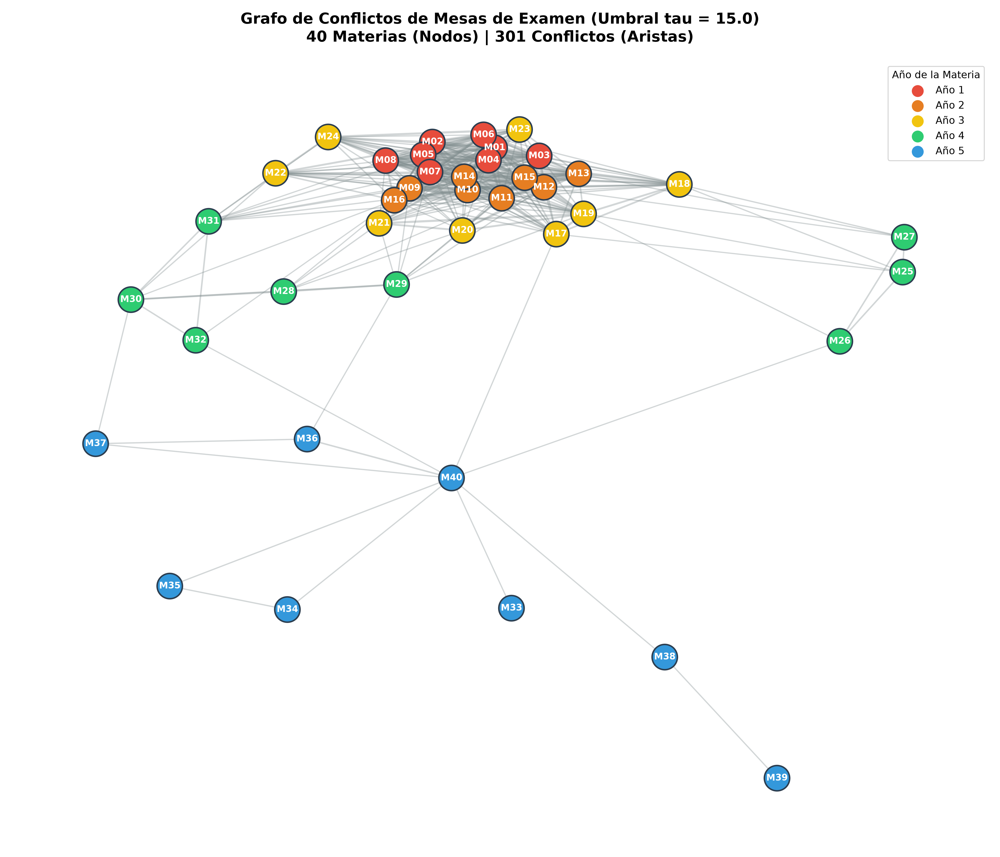

*Generado con NetworkX + Matplotlib. Los colores de los nodos representan los turnos asignados por Welsh-Powell. Las aristas representan pares de materias que no pueden compartir turno.*

---

## 5. Integración: modelo → grafo → frontend

### Flujo de datos

```
Usuario mueve slider τ (frontend)
        ↓
GET /cronograma?umbral={τ}  (FastAPI)
        ↓
build_graph(τ)       → graph/build.py (NetworkX)
        ↓
welsh_powell(G)      → graph/coloring.py
        ↓
{ materias: [...], aristas: [...], turnos: {...} }
        ↓
Cytoscape.js renderiza grafo + CronogramaGrid muestra tabla por turno
```

### Endpoints de la API

La API se levanta con `uvicorn app.main:app --port 8000`. Los endpoints principales son:

| Método | Ruta | Descripción |
|---|---|---|
| `GET` | `/` | Health check — devuelve `{"status": "ok"}` |
| `GET` | `/materias` | Lista las 40 materias del catálogo |
| `GET` | `/conflictos?umbral={τ}` | Pares con conflicto predicho ≥ τ |
| `GET` | `/cronograma?umbral={τ}` | Grafo coloreado + distribución por turno |
| `GET` | `/metricas` | Métricas del modelo desde `metricas.json` |

Ejemplo de respuesta de `/cronograma?umbral=15`:

```json
{
  "umbral": 15,
  "n_aristas": 275,
  "n_turnos": 18,
  "turnos": {
    "1": ["Análisis Matemático I", "Física I", ...],
    "2": ["Álgebra", "Química General", ...],
    ...
  },
  "aristas": [
    {"materia1": "Análisis Matemático I", "materia2": "Álgebra", "prediccion": 42.3},
    ...
  ]
}
```

### Frontend

El frontend está en `frontend/` y se levanta con `npm run dev` (puerto 5173).

**Stack:** React 19 + TypeScript + Vite + Tailwind CSS + Cytoscape.js

**Componentes principales:**

| Componente | Función |
|---|---|
| `App.tsx` | Estado global del umbral τ, fetch al backend, coordinación |
| `UmbralSlider.tsx` | Deslizador con presets (Estricto 5 / Recomendado 15 / Moderado 30 / Permisivo 50) |
| `GrafoConflictos.tsx` | Renderizado del grafo con Cytoscape.js, layout cola, colores por turno |
| `CronogramaGrid.tsx` | Tabla de materias agrupadas por turno, chips de color, buscador |
| `MetricsPanel.tsx` | Métricas del modelo (MAE, RMSE, R², F1) desde `/metricas` |
| `KpiBar.tsx` | Indicadores rápidos: aristas, turnos, densidad del grafo |

**Debounce:** el slider usa un debounce de 350 ms antes de disparar el fetch al backend, para no saturar la API mientras el usuario arrastra el control.

---

## 6. Capturas de pantalla

### 6.1 Frontend — Variación del umbral

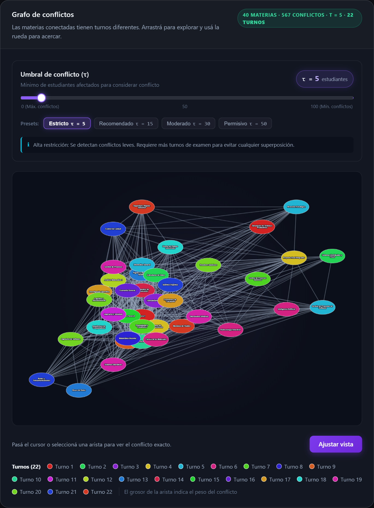

**Umbral τ=5 (Estricto):** con un umbral muy bajo, casi cualquier par de materias que comparte 5 o más alumnos genera una arista. El resultado es un grafo con 567 aristas y 22 turnos necesarios. El sistema es muy conservador: se maximiza la separación de materias a costa de necesitar más turnos de examen.

---

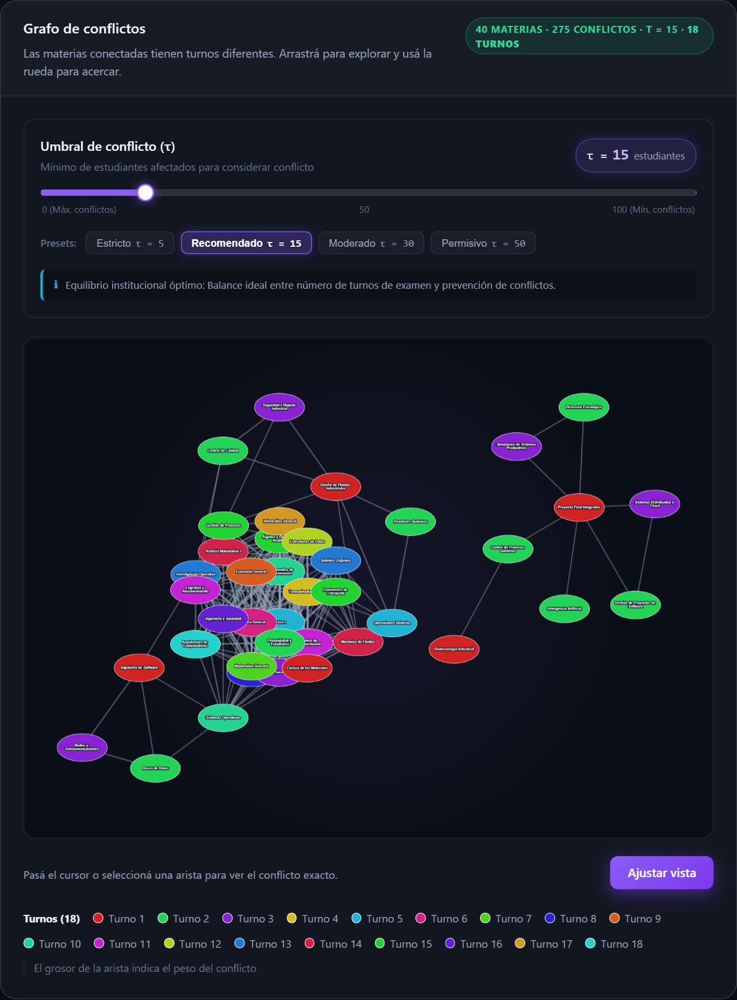

**Umbral τ=15 (Recomendado):** configuración de equilibrio. El grafo tiene 275 aristas y requiere 18 turnos. Esta es la configuración por defecto del sistema y la que mejor balancea protección al estudiante vs. compactación del calendario.

---

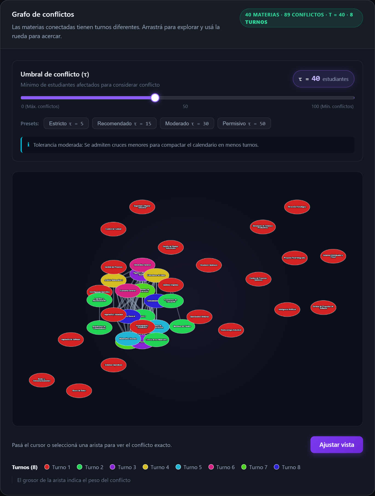

**Umbral τ=40 (Permisivo):** solo los conflictos más severos generan aristas. El grafo queda con 89 aristas y solo 8 turnos son necesarios. El calendario es más compacto pero algunos pares con 20–39 alumnos en común podrían quedar en el mismo turno.

### 6.2 Vista de cronograma

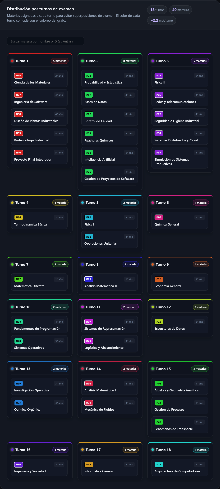

**CronogramaGrid:** tabla organizada por turno (columna) donde cada chip de color corresponde a un turno del grafo. El buscador superior permite filtrar materias y ver en cuál turno quedaron asignadas. Los colores están sincronizados con los nodos del grafo de Cytoscape.

---

## 7. Limitaciones y extensiones posibles

### Limitaciones actuales

| Limitación | Impacto |
|---|---|
| **Dataset 100% sintético** | Las relaciones entre features y target son lineales por diseño. Con datos reales de inscripciones, el comportamiento podría ser más complejo y un modelo lineal no sería suficiente. |
| **Coloreo no garantiza el óptimo** | Welsh-Powell es una heurística. La solución puede usar más turnos de los estrictamente necesarios. El problema de coloreo cromático óptimo es NP-difícil. |
| **Sin restricciones de aulas o docentes** | El sistema solo evita que dos materias con muchos alumnos en común coincidan. No considera disponibilidad de aulas, disponibilidad de docentes ni cantidad de estudiantes totales por turno. |
| **Modelo entrenado con un solo dataset** | No hay validación cruzada con múltiples particiones. Los resultados son robustos para este dataset sintético pero no extrapolables directamente. |
| **Umbral τ es global** | El mismo umbral aplica a todos los pares. Un sistema más sofisticado podría tener umbrales por año o por área. |

### Extensiones posibles

- **Datos reales:** integrar con el sistema SIU-Guaraní para obtener inscripciones reales y reemplazar el dataset sintético.
- **Restricciones adicionales:** modelar disponibilidad de aulas y docentes como restricciones adicionales en el grafo o como un problema de programación con restricciones (CSP).
- **Backtracking exacto:** para instancias pequeñas (≤ 20 materias), un coloreo exacto por backtracking sería factible y garantizaría el mínimo de turnos.
- **Modelo no-lineal:** con datos reales, explorar Random Forest o Gradient Boosting para capturar interacciones no-lineales entre features.
- **Exportación del cronograma:** botón para exportar el calendario a PDF o CSV para uso directo por la secretaría.

---

## 8. Uso de inteligencia artificial

El detalle completo del uso de IA durante el desarrollo del trabajo está documentado en [`informe/uso_ia.md`](uso_ia.md).

**Resumen ejecutivo:**

Usamos GitHub Copilot y ChatGPT principalmente como acelerador en tres áreas:
- Boilerplate de React/TypeScript (componentes base, tipos de datos).
- Documentación inicial y comentarios de funciones.
- Búsqueda de errores puntuales (typos, incompatibilidades de versiones).

**No usamos IA para:**
- La definición del algoritmo Welsh-Powell ni su implementación central.
- La elección de features y la construcción del dataset.
- La selección del modelo y la interpretación de métricas.
- La arquitectura general del sistema (cómo conectar ML + grafos + API + frontend).

**Un caso donde la IA se equivocó:** ChatGPT sugirió usar `nx.coloring.greedy_color(G, strategy='largest_first')` de NetworkX directamente. Lo descartamos porque necesitábamos control explícito sobre el orden de coloreo (Welsh-Powell con grado descendente) y la función de NetworkX no expone ese orden de forma directa. Implementamos el algoritmo a mano en `coloring.py`.

---

*Informe generado en Noviembre de 2026 — UTN FRRo*
