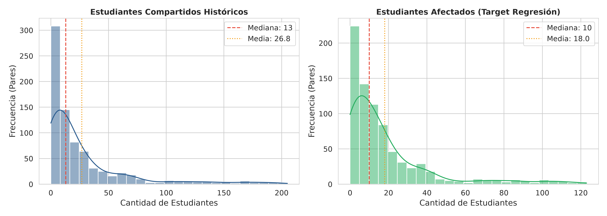
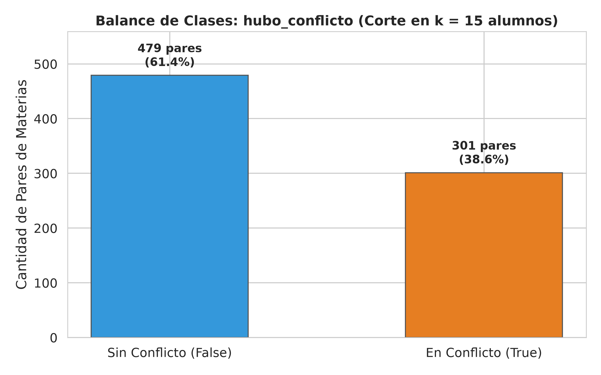
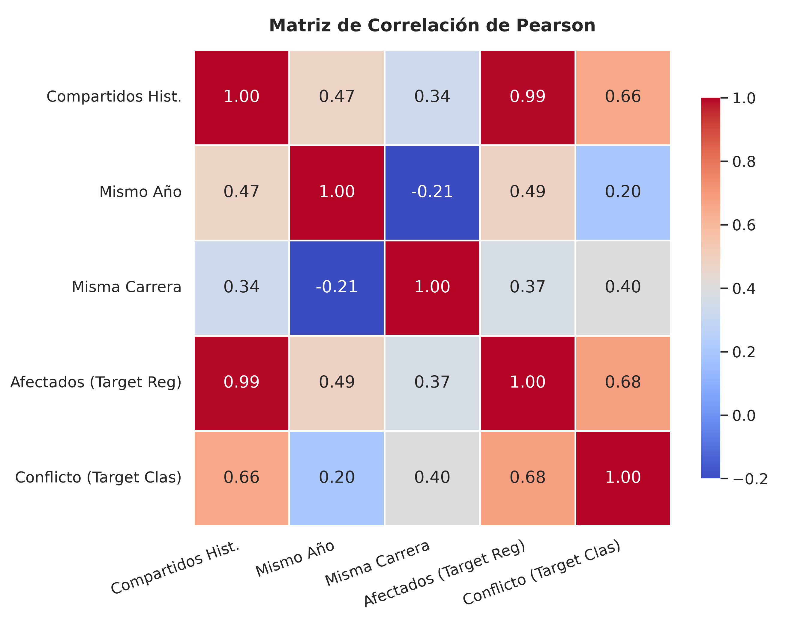
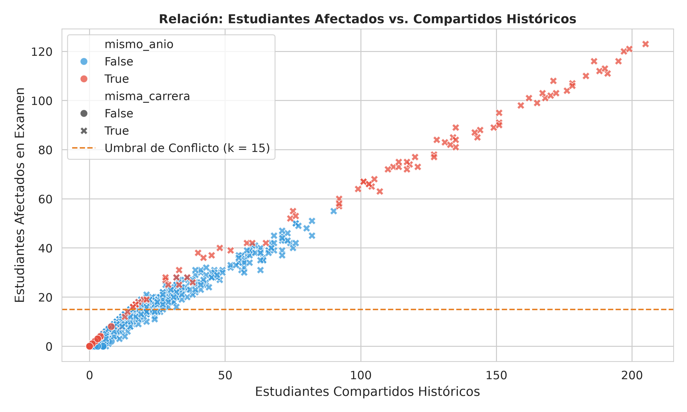

# Análisis Exploratorio de Datos (EDA) — Ticket T06

**Proyecto:** Planificación de Mesas de Examen mediante Grafos y Machine Learning  
**Dataset:** `backend/data/pares_materias.csv`  
**Observaciones:** 780 pares de materias ($\binom{40}{2}$)  
**Script generador de gráficos:** `backend/data/eda.py`

---

## 1. Resumen General e Integridad de los Datos

El dataset está conformado por **780 filas** (cada una representando un par único no dirigido de materias $M_1, M_2$) y **7 variables**.

| Campo | Tipo | Valores Nulos | Descripción |
|---|---|:---:|---|
| `materia_id_1` | `str` | 0 | Identificador de la primera materia |
| `materia_id_2` | `str` | 0 | Identificador de la segunda materia |
| `cant_estudiantes_compartidos_historico` | `int` | 0 | Estudiantes con ambas materias en historial común |
| `mismo_anio` | `bool` | 0 | Ambas materias pertenecen al mismo año lectivo |
| `misma_carrera` | `bool` | 0 | Comparten plan de estudio o tronco común |
| `cant_estudiantes_afectados` | `int` | 0 | **Target continuo (Regresión)** |
| `hubo_conflicto` | `bool` | 0 | **Target binario (Clasificación)** |

> [!NOTE]
> La integridad del dataset es del **100%**: no existen valores nulos ni registros faltantes en ninguna de las columnas.

---

## 2. Estadísticas Descriptivas de las Variables Continuas

| Métrica | Compartidos Históricos | Afectados (Target Regresión) |
|---|:---:|:---:|
| **Conteo** | 780 | 780 |
| **Media** | 26.81 | 18.02 |
| **Desvío Estándar ($\sigma$)** | 38.11 | 23.15 |
| **Mínimo** | 0 | 0 |
| **Percentil 25% ($Q_1$)** | 4.00 | 3.00 |
| **Mediana ($Q_2$)** | 13.00 | 10.00 |
| **Percentil 75% ($Q_3$)** | 31.00 | 21.25 |
| **Máximo** | 205.00 | 123.00 |

### Distribución y Asimetría
Ambas variables continuas presentan una pronunciada **asimetría hacia la derecha** (*right-skewed*), donde la media ($26.81$ y $18.02$) es significativamente superior a la mediana ($13$ y $10$). 

Esto es conceptualmente consistente con la dinámica universitaria: la mayoría de los pares de materias comparten pocos estudiantes (especialidades de carreras o años alejados), mientras que un grupo selecto de pares de materias básicas masivas (Álgebra, Análisis, Física) concentra volúmenes elevados de inscriptos.

---

## 3. Balance de Clases de la Variable Objetivo (`hubo_conflicto`)

Para la formulación de **clasificación binaria**, se definió el conflicto institucional mediante el umbral $k = 15$ estudiantes:
$$\text{hubo\_conflicto} = (\text{cant\_estudiantes\_afectados} \ge 15)$$

| Categoría | Pares | Proporción |
|---|:---:|:---:|
| **Sin Conflicto (`False`)** | 479 | **61.41%** |
| **En Conflicto (`True`)** | 301 | **38.59%** |
| **Total** | 780 | 100.0% |

> [!TIP]
> **Balance óptimo para ML:** La proporción ~61% / 39% asegura que los modelos de clasificación puedan entrenarse con funciones de pérdida estándar sin sesgarse hacia una clase mayoritaria ni requerir técnicas artificiales como SMOTE o sobremuestreo.

---

## 4. Matriz de Correlación

Se computaron los coeficientes de correlación de Pearson ($r$) entre todas las variables (codificando booleanas como 0/1):

| Variable | Compartidos Hist. | Mismo Año | Misma Carrera | Afectados (Reg) | Conflicto (Clas) |
|---|:---:|:---:|:---:|:---:|:---:|
| **Compartidos Hist.** | **1.000** | 0.473 | 0.338 | **0.994** | 0.658 |
| **Mismo Año** | 0.473 | **1.000** | 0.126 | 0.490 | 0.199 |
| **Misma Carrera** | 0.338 | 0.126 | **1.000** | 0.347 | 0.404 |
| **Afectados (Reg)** | **0.994** | 0.490 | 0.347 | **1.000** | **0.681** |
| **Conflicto (Clas)** | 0.658 | 0.199 | 0.404 | **0.681** | **1.000** |

### Observaciones de Correlación
1. **$r(\text{Compartidos}, \text{Afectados}) = 0.994$:** Relación lineal dominante casi perfecta, coherente con la regla generativa donde la cantidad de afectados es una fracción directa de los alumnos históricos disponibles.
2. **$r(\text{Mismo Año}, \text{Compartidos}) = 0.473$:** Las materias del mismo año tienen sistemáticamente más alumnos compartidos.
3. **$r(\text{Misma Carrera}, \text{Conflicto}) = 0.404$:** Pertenecer a la misma carrera o tronco común es un fuerte discriminador de si se supera el umbral crítico de conflicto.

---

## 5. Análisis Bivariado y Dispersión

### Impacto de los Factores Académicos en la Tasa de Conflicto:

1. **Impacto de `misma_carrera`:**
   * Cuando `misma_carrera = False`: **0.00%** de conflicto (0 de 161 pares superan los 15 afectados).
   * Cuando `misma_carrera = True`: **48.63%** de conflicto (301 de 619 pares están en conflicto).
   * *Conclusión:* Si dos materias no tienen alumnos en común por carrera o tronco común, el conflicto es nulo en la práctica.

2. **Impacto de `mismo_anio`:**
   * En años distintos (`mismo_anio = False`): **34.06%** de conflicto.
   * En el mismo año (`mismo_anio = True`): **59.29%** de conflicto.
   * *Conclusión:* El factor de simultaneidad de cursada casi duplica la probabilidad de que las materias requieran turnos separados.

---

## 6. Conclusiones y Guía para los Próximos Tickets (T07 y T08)

1. **Para T07 (Decisión de Regresión vs Clasificación):**
   * El target continuo `cant_estudiantes_afectados` permite alimentar de manera natural los **pesos de las aristas del grafo de conflictos** ($w_{ij} = \text{afectados}$), facilitando un umbral dinámico $\tau$ configurable en el frontend.
   * El target discreto `hubo_conflicto` presenta un balance de clases ideal (61/39), lo que habilitaría modelos de clasificación con métricas sólidas de F1-Score y AUC-ROC.
2. **Para T08 (Pipeline de Features y Preprocesamiento):**
   * Las variables predictoras candidatas (`cant_estudiantes_compartidos_historico`, `mismo_anio`, `misma_carrera`) no presentan nulos y tienen distribuciones bien definidas.
   * Se requerirá un `StandardScaler` o `RobustScaler` para la variable numérica de compartidos debido a la asimetría y valores extremos, y un `OneHotEncoder` / passthrough booleano para las variables categóricas.
