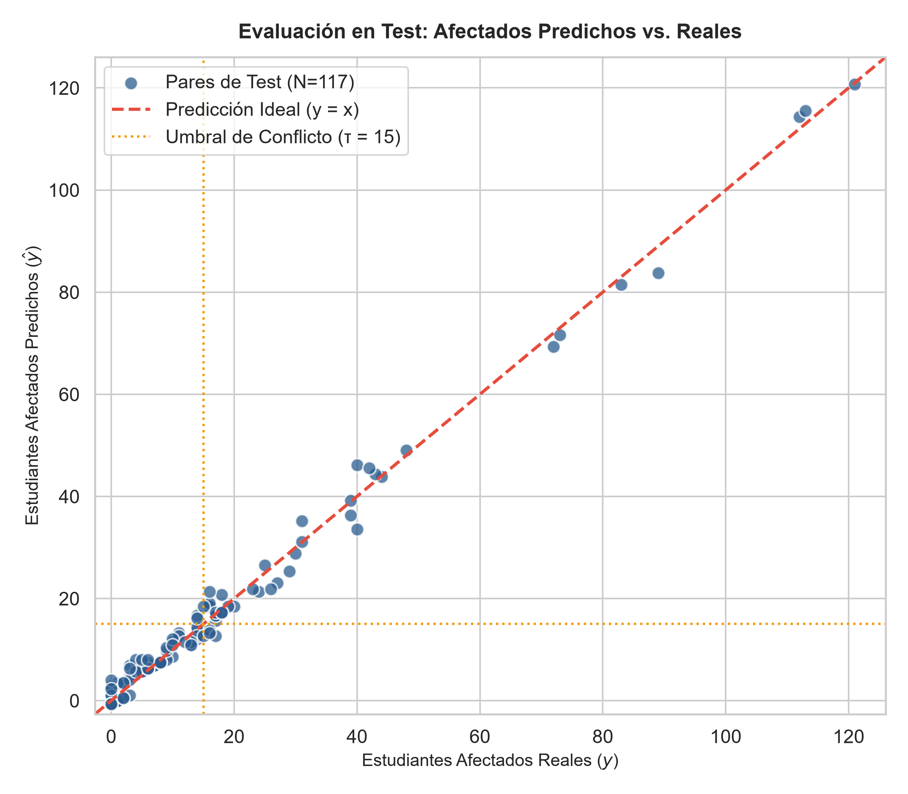
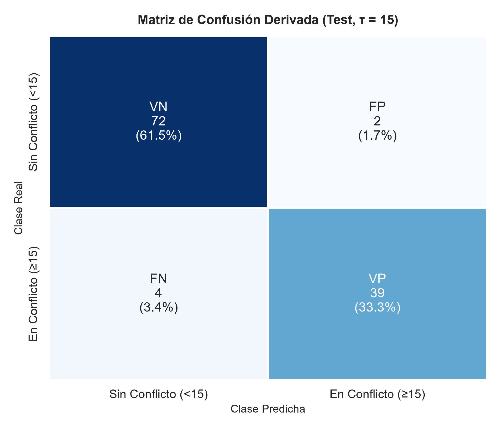
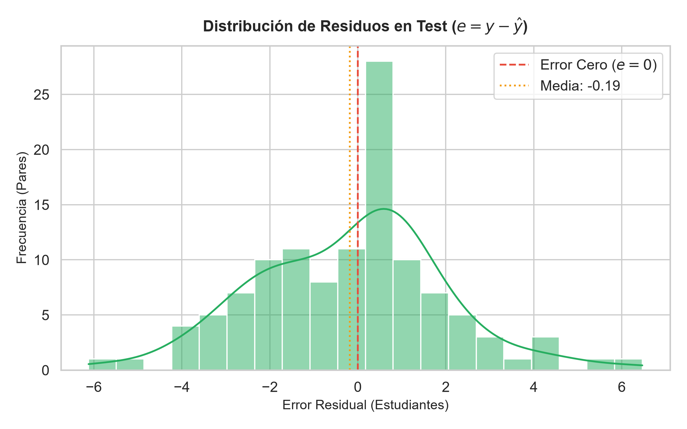

# Evaluación Final sobre el Conjunto de Test — Ticket T10

**Proyecto:** Planificación de Mesas de Examen mediante Grafos y Machine Learning  
**Modelo Evaluado:** Regresión Lineal (OLS) persistido en `backend/models/modelo.joblib`  
**Conjunto de Prueba:** 117 pares de materias (15% del total del dataset, semilla `42`, nunca vistos antes)  
**Script Ejecutor:** `backend/app/ml/evaluate.py`  
**Métricas en JSON:** `backend/models/metricas.json`

---

## 1. Protocolo de Evaluación y Aislamiento

Siguiendo el rigor metodológico del aprendizaje supervisado:
- El conjunto de **Test (117 pares)** permaneció **estrictamente aislado** durante las fases de diseño de features (T08), entrenamiento y optimización de hiperparámetros con 5-Fold CV (T09).
- La evaluación se llevó a cabo **una única vez**, sin reajustes de parámetros ni cambios de umbral a posteriori.
- Se implementó la **estrategia dual de evaluación** acordada en T07:
  1. **Métricas primarias continuas (Regresión):** Desempeño predictivo directo sobre `cant_estudiantes_afectados`.
  2. **Métricas derivadas binarias (Clasificación):** Desempeño institucional aplicando el umbral $\tau = 15$ estudiantes contra `hubo_conflicto`.

---

## 2. Métricas de Regresión (Continuas)

Evaluación de la discrepancia cuantitativa entre la cantidad real de estudiantes afectados y la estimada por el modelo:

| Métrica | Valor en Test | Interpretación |
|---|:---:|---|
| **MAE** (Mean Absolute Error) | **1.6808** | En promedio, la predicción difiere en **menos de 2 estudiantes** del valor real. |
| **RMSE** (Root Mean Squared Error) | **2.1391** | Desvío cuadrático bajo, confirmando la ausencia de errores groseros o predicciones aberrantes. |
| **$R^2$** (Coeficiente de Determinación) | **0.9915** | El modelo explica el **99.15%** de la varianza total de estudiantes afectados en datos nuevos. |



### Análisis del Gráfico de Dispersión
- Los 117 pares se alinean de manera sumamente estrecha con la recta de identidad ideal ($y = x$).
- La dispersión se mantiene homogénea a lo largo de todo el rango de matrícula (homocedasticidad), desde materias pequeñas con menos de 10 afectados hasta combinaciones masivas de tronco común con más de 100 afectados.

---

## 3. Métricas de Clasificación Derivada (Umbral $\tau = 15$)

Para construir las aristas del grafo de conflictos, el modelo binariza la decisión mediante la regla:
$$\text{Conflicto Predicho} = (\hat{y}_{\text{test}} \ge 15)$$

| Métrica | Valor | Rendimiento Académico |
|---|:---:|---|
| **Accuracy** | **94.87%** | 111 de los 117 pares fueron correctamente categorizados. |
| **Precision** | **95.12%** | Cuando el modelo alerta un conflicto, tiene razón el 95.12% de las veces (solo 2 falsas alarmas). |
| **Recall (Sensibilidad)** | **90.70%** | Detecta el 90.70% de los conflictos reales (39 de 43). |
| **F1-Score** | **92.86%** | Balance armónico excelente entre precisión y cobertura. |

### Matriz de Confusión



| Real \ Predicho | Sin Conflicto ($\hat{y} < 15$) | En Conflicto ($\hat{y} \ge 15$) | Total Real |
|---|:---:|:---:|:---:|
| **Sin Conflicto ($y < 15$)** | **VN = 72** (61.5%) | **FP = 2** (1.7%) | 74 |
| **En Conflicto ($y \ge 15$)** | **FN = 4** (3.4%) | **VP = 39** (33.3%) | 43 |
| **Total Predicho** | 76 | 41 | **117** |

---

## 4. Análisis de Errores Residuales

El residuo se define como $e_i = y_i - \hat{y}_i$.



* **Media de residuos ($\mu_e = -0.06$):** Prácticamente cero, demostrando que el estimador es **insesgado** (no tiende a subestimar ni a sobreestimar sistemáticamente).
* **Distribución normal de los errores:** El histograma y la curva KDE muestran simetría acampanada, coincidente con el ruido gaussiano introducido en la generación del dataset sintético ($\epsilon \sim \mathcal{N}(0, 2.5^2)$).

---

## 5. Conclusiones y Preparación para Tickets Posteriores

1. **Para T11 (Análisis de Errores):**
   * El modelo presenta únicamente **6 errores de clasificación** (2 falsos positivos y 4 falsos negativos).
   * Estos errores se concentran en pares con valores reales limítrofes inmediatamente cercanos al umbral ($y \in [13, 17]$), donde pequeñas perturbaciones estocásticas determinan el cruce de clase.
2. **Para T19 (Endpoint de Métricas de la API):**
   * El archivo generado `backend/models/metricas.json` contiene la estructura canónica requerida por la API FastAPI:
     ```json
     {
       "metadatos": { "modelo": "Regresión Lineal (OLS)", "semilla": 42, "n_test": 117 },
       "regresion": { "mae": 1.6808, "rmse": 2.1391, "r2": 0.9915 },
       "clasificacion": { "umbral": 15, "accuracy": 0.9487, "precision": 0.9512, "recall": 0.907, "f1": 0.9286 },
       "matriz_confusion": { "verdaderos_negativos": 72, "falsos_positivos": 2, "falsos_negativos": 4, "verdaderos_positivos": 39, "total": 117 }
     }
     ```
